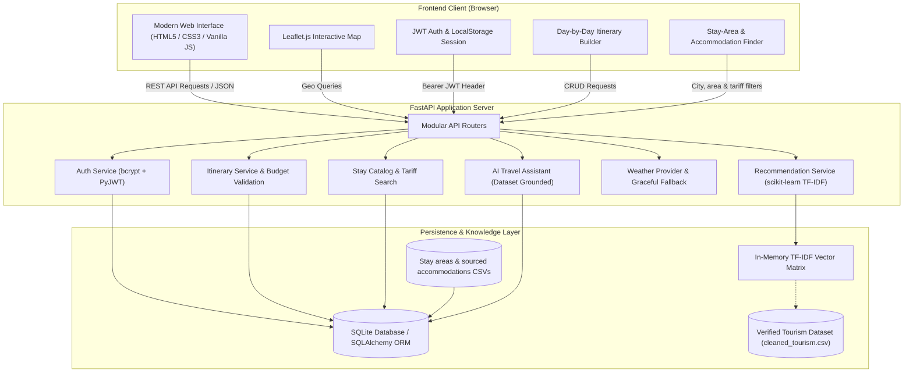
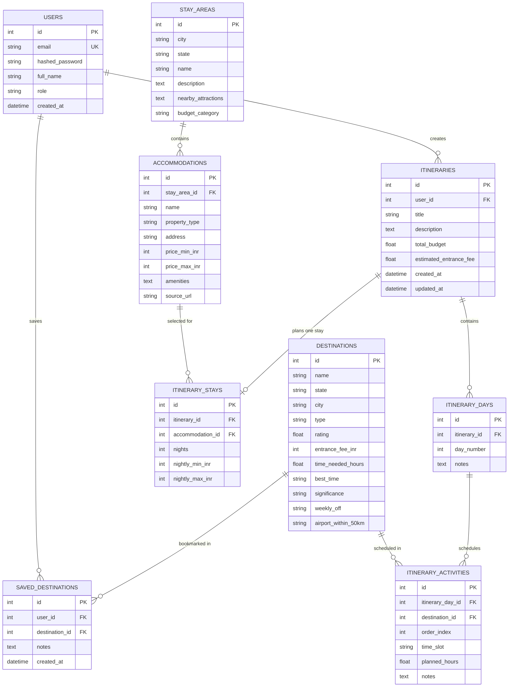

# Technical Architecture & System Design Documentation

**Project Title:** AI-Based Personalized Tourism Recommendation System  
**Version:** 2.0.0  
**Stack:** FastAPI, Python 3.12, scikit-learn, SQLAlchemy, SQLite, HTML5, CSS3, JavaScript, Leaflet.js

---

## 1. System Architecture Overview

The system is organized into a clean, 3-tier decoupled architecture:
1. **Frontend Presentation Tier:** Single-page responsive web client with navigation tabs, interactive Leaflet maps, a stay-area and accommodation planner, a multi-day itinerary builder, and modal dialogs.
2. **Backend Application & Service Tier:** High-performance asynchronous FastAPI service with modular API routers, JWT authentication, and in-memory TF-IDF caching.
3. **Data & Persistence Tier:** Relational database (SQLite locally, scalable to PostgreSQL) managed via SQLAlchemy ORM, alongside verified CSV datasets.

---

## 2. Recommendation Algorithm Formulation

The core recommendation engine combines **Content-Based Filtering (Machine Learning / NLP)** with **Multi-Factor Business Rule Constraints**.

### 2.1 Content-Based Similarity (TF-IDF & Cosine Similarity)
A rich text document is constructed for every destination in the dataset:
$$\text{Document}_i = \text{Type}_i \parallel \text{Type}_i \parallel \text{Significance}_i \parallel \text{Significance}_i \parallel \text{Name}_i \parallel \text{City}_i \parallel \text{State}_i \parallel \text{BestTime}_i$$

*Note: $\text{Type}$ and $\text{Significance}$ are repeated to assign higher term-frequency weight to attraction categories in the vocabulary space.*

The vocabulary is transformed using scikit-learn's `TfidfVectorizer(ngram_range=(1, 2), stop_words='english')`. Given a user's interest query string $Q$, the query vector $\vec{v}_Q$ is matched against each destination vector $\vec{v}_i$ using Cosine Similarity:
$$\text{Sim}(Q, i) = \frac{\vec{v}_Q \cdot \vec{v}_i}{\|\vec{v}_Q\| \|\vec{v}_i\|} \in [0.0, 1.0]$$

If no specific interest keywords are provided by the user, $\text{Sim}(Q, i)$ is assigned a neutral baseline of $0.50$.

### 2.2 Multi-Factor Scoring Factors
1. **Rating Factor ($S_{\text{rating}}$):**
   $$S_{\text{rating}} = \frac{\text{Rating}}{5.0} \in [0.0, 1.0]$$
2. **Affordability Factor ($S_{\text{afford}}$):**
   $$S_{\text{afford}} = \max\left(0, 1.0 - \frac{\text{Entrance Fee}}{\max(\text{Budget}, 1.0)}\right) \in [0.0, 1.0]$$
3. **Duration Fit Factor ($S_{\text{duration}}$):**
   $$S_{\text{duration}} = \max\left(0, 1.0 - \left|\frac{\text{Time Needed}}{\text{Available Hours}} - 0.5\right| \times 0.5\right) \in [0.0, 1.0]$$
4. **Preferred Time Factor ($S_{\text{time}}$):**
   $$S_{\text{time}} = \begin{cases} 1.0 & \text{if preferred period matches or best time is 'All'} \\ 0.2 & \text{otherwise} \end{cases}$$

### 2.3 Composite Recommendation Score
The final score (scaled to $[0, 100]$) is computed using documented, configurable weights:
$$\text{Score} = \left( 0.35 \times \text{Sim}(Q, i) + 0.25 \times S_{\text{rating}} + 0.15 \times S_{\text{afford}} + 0.15 \times S_{\text{duration}} + 0.10 \times S_{\text{time}} \right) \times 100$$

---

## 3. Database Entity-Relationship Model

---

## 4. API Endpoints Directory

| Method | Endpoint | Description | Protected |
| :--- | :--- | :--- | :--- |
| `GET` | `/` | System status & API version | No |
| `GET` | `/health` | Application health check | No |
| `GET` | `/recommend` | Personalized TF-IDF recommendation engine | No |
| `GET` | `/destinations` | Paginated catalog search and filters | No |
| `GET` | `/destinations/{id}` | Full destination detail lookup | No |
| `GET` | `/states` | List of all available Indian states | No |
| `GET` | `/destination-types` | List of unique attraction types | No |
| `GET` | `/stay-areas` | Suggested neighborhoods by city or state | No |
| `GET` | `/accommodations` | Filter accommodation by city, destination, area, type, and nightly tariff | No |
| `POST` | `/auth/register` | Register new user account | No |
| `POST` | `/auth/login` | Login and receive Bearer JWT token | No |
| `GET` | `/users/me` | Retrieve profile of authenticated user | Yes (User) |
| `GET` | `/users/me/saved-destinations` | List user's bookmarked destinations | Yes (User) |
| `POST` | `/users/me/saved-destinations` | Bookmark destination | Yes (User) |
| `DELETE` | `/users/me/saved-destinations/{id}` | Remove bookmarked destination | Yes (User) |
| `POST` | `/itineraries` | Create multi-day itinerary with activities and an optional stay plan | Yes (User) |
| `GET` | `/itineraries` | List all user itineraries | Yes (User) |
| `GET` | `/itineraries/{id}` | Get specific itinerary details | Yes (User) |
| `PUT` | `/itineraries/{id}` | Update itinerary title, budget, days, or stay plan | Yes (User) |
| `DELETE` | `/itineraries/{id}` | Delete itinerary | Yes (User) |
| `GET` | `/weather` | Weather forecast or seasonal climate guidance | No |
| `POST` | `/assistant/chat` | Dataset-grounded AI tourism chatbot | No |
| `GET` | `/admin/stats` | System metrics, users count, catalog volume | Yes (Admin) |

---

## 5. Security & Verification Strategy
- **Password Security:** Salted hashing with `bcrypt` (work factor 12).
- **Authentication:** Stateless JSON Web Tokens (`HS256`) with 24-hour expiration.
- **Resource Ownership:** All itinerary and saved destination operations verify that the authenticated `user_id` matches the resource owner.
- **Data Validation:** Strict Pydantic models validate input types, regex strings, and range constraints prior to execution.
